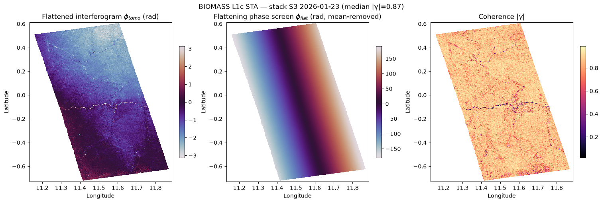
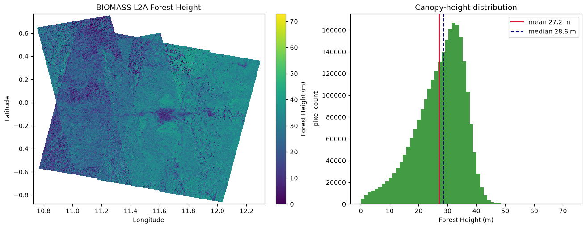
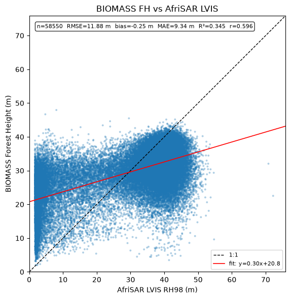
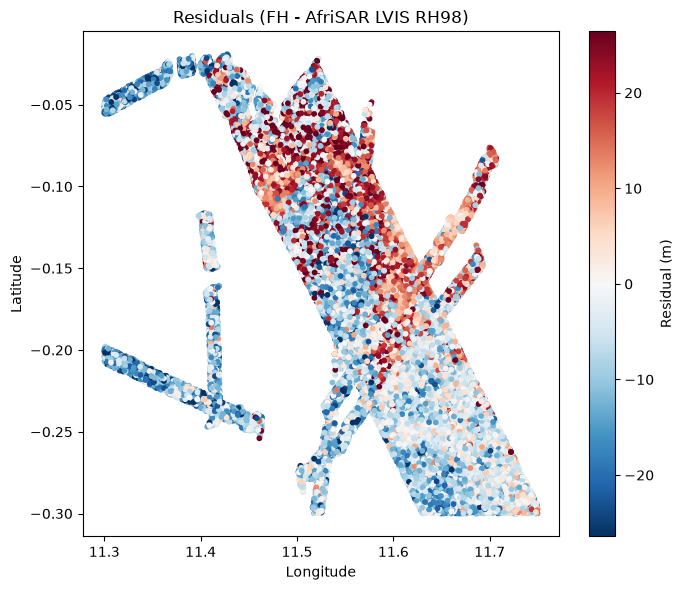
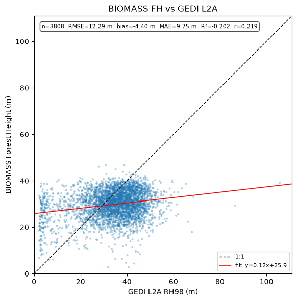
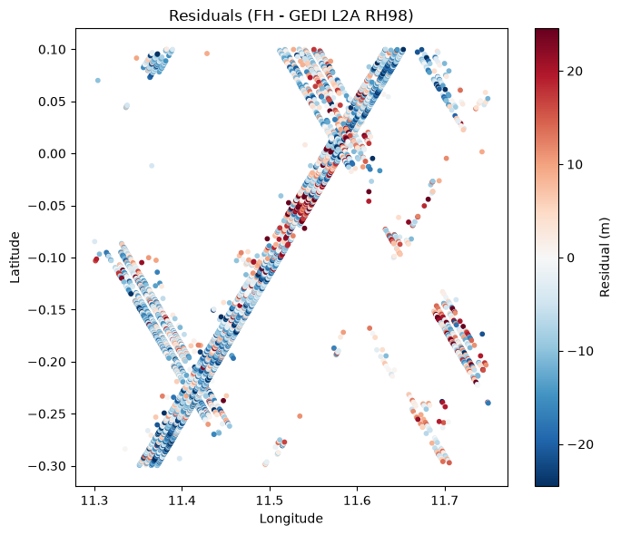

## Introduction to ESA BIOMASS Remote Sensing

BIOMASS is a European Space Agency (ESA) mission designed to provide global measurements of forest biomass and carbon stocks. The mission uses a P-band **Synthetic Aperture Radar (SAR)** to penetrate dense forest canopies and retrieve accurate forest information.

As an introduction to remote sensing radar data, I created a Python notebook to retrieve and analyze ESA BIOMASS datasets. The project focuses on understanding the data formats, processing techniques, and practical applications. BIOMASS data is hosted on the ESA MAAP catalogue and it is accessed using the `pystac-client` library. The notebook walks through the data progression from **Level-1C Stack Interferometric products** (co-registered, phase-calibrated sequences of SAR data) up to **Level-2A Forest Height estimation**. Finally, I ran a benchmark comparison against two independent NASA LiDAR references (AfriSAR LVIS and GEDI L2A) retrieved using the `earthaccess` library.

### Results

The Level-1C stack: flattened interferogram, flattening phase screen and interferometric coherence.

The Level-2A forest height product and its canopy-height distribution (mean 27.2 m, median 28.6 m).

Benchmark against AfriSAR LVIS airborne LiDAR (RH98): RMSE 11.88 m, bias -0.25 m, r = 0.60.

Benchmark against GEDI L2A spaceborne LiDAR (RH98): RMSE 12.29 m, bias -4.40 m, r = 0.22.

This notebook serves as a practical starting point for ESA BIOMASS remote sensing, providing a solid foundation for further exploration into forest information retrieval using radar data and interferometry techniques.